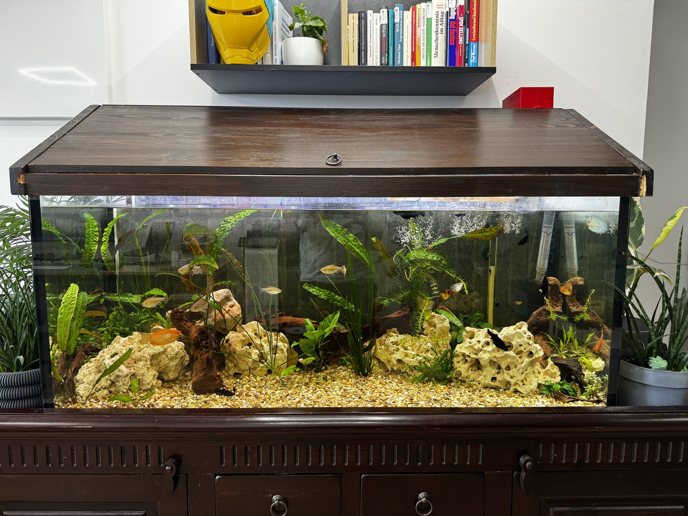
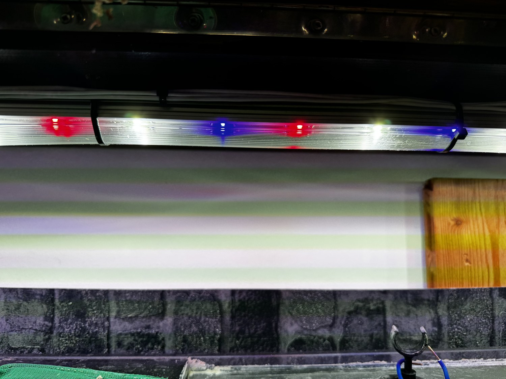
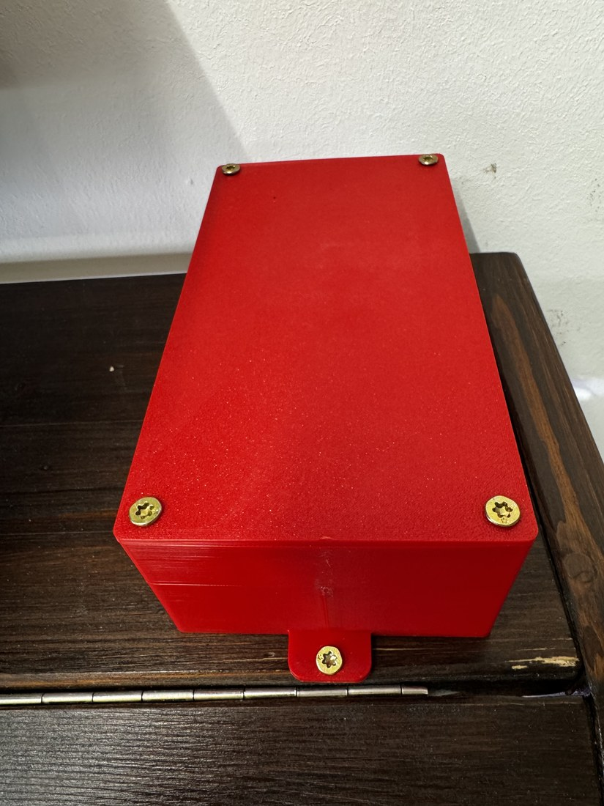

# Aquariumlicht für ein 400-Liter-Süßwasserbecken

Ein Projekt von **smartathome**. Für unser bepflanztes Gesellschaftsbecken ohne CO₂-Zugabe haben wir eine dimmbare LED-Leuchte mit drei Farbkanälen aufgebaut. Die Leuchte sitzt rund 75 cm über dem Beckenboden. Ein ESP32-WROOM-32 berechnet den Lichtverlauf selbst. Home Assistant dient zur Bedienung und Anzeige.



## Die Leuchte

Wir verwenden 26 Cree-LEDs auf 20-mm-Sternplatinen. Die weißen LEDs sind über das Aluminiumprofil verteilt. Zwei Weißketten teilen sich das Dimmsignal, haben aber je einen eigenen Konstantstromtreiber.

| Kanal | Bestückung | Ketten |
| --- | --- | --- |
| Weiß | 12 × Cree XP-G3 R3, 5700 K, CRI 90+, [LT-2842](https://www.led-tech.de/de/CREE-XP-G3-R3-CRI-90-5700k-auf-Star) | 2 × 6 in Reihe |
| Rot | 8 × Cree XP-G3 Photo Red, 660 nm nominal, [LT-4076](https://www.led-tech.de/en/CREE-XP-G3-Photo-Red-on-Star) | 1 × 8 in Reihe |
| Blau | 6 × Cree XP-G3 Royal Blue, [LT-2855](https://www.led-tech.de/de/CREE-XP-G3-Royal-Blau-auf-Star) | 1 × 6 in Reihe |

Weiß macht den Hauptteil des Tageslichts aus. Mit Rot und Blau gestalten wir die Farbstimmung beim Auf- und Untergang. Das LED-Profil sitzt unter der Holzabdeckung. Die Steuerung steckt in einer separaten, verschraubten Box.

| LED-Profil im Betrieb | Gehäuse der Steuerung |
| --- | --- |
|  |  |

Der [Schaltplan](docs/schaltplan.md) dokumentiert die geplante Verdrahtung. Das Innere der Steuerbox, die Treiberaufdrucke und das Netzteiletikett sind auf den Fotos nicht sichtbar.

## Vergleich mit einer fertigen Leuchte

Als Vergleich dient die **JUWEL HeliaLux Spectrum 1200**, eine fertige Süßwasserleuchte mit 60 W laut Hersteller. Die Tabelle vergleicht Bauart und Steuerung. Messwerte für Leistungsaufnahme und Lichtmenge der Eigenbauleuchte liegen nicht vor.

| Merkmal | smartathome Aquariumlicht | JUWEL HeliaLux Spectrum 1200 |
| --- | --- | --- |
| Aufbau | 26 einzelne LEDs auf Sternplatinen im Aluminiumprofil | Fertige LED-Einsatzleuchte |
| Lichtfarben | Weiß (5700 K), Rot und Royalblau | Weiß (6500 K und 9000 K), Rot, Grün und Blau |
| Tagesverlauf | ESP32 mit eigener Lichtkurve und optionaler Home-Assistant-Bedienung | Programmierbare Lichtphasen mit JUWEL HeliaLux AppControl |

JUWEL sieht die Montage mit UniversalFit nur für offene Aquarien vor. Für unser Becken mit Holzabdeckung dient die Leuchte deshalb als Vergleich für Bauart und Funktionen. [Herstellerangaben zur HeliaLux Spectrum](https://www.juwel-aquarium.de/de/zubehoer/beleuchtung/led/helialux-spectrum)

## Der Tagesverlauf

| Uhrzeit | Licht |
| --- | --- |
| 09:00–09:45 | Rötlicher Sonnenaufgang |
| 09:45–16:15 | Tageslicht mit bis zu drei optionalen Wolkendurchgängen |
| 16:15–17:00 | Sonnenuntergang |
| 17:00–19:00 | Optionales Mondlicht mit 2 % Blau |

Bei 100 % Gesamtintensität liegt das Tagesprofil bei **100 % Weiß, 35 % Rot, 20 % Blau**. Das sind Bedienwerte vor der ESPHome-Gamma-Korrektur von 1,4. Wolken dimmen den Tagesverlauf um bis zu 25 %. Der ESP aktualisiert das Ziel alle 30 Sekunden. Werte unter 2 % schalten den jeweiligen Kanal aus. Das Mondlicht hat einen eigenen festen Sollwert.

Nach der ersten Zeitsynchronisation läuft derselbe Tagesplan bei WLAN- oder Home-Assistant-Ausfall mit den zuletzt übernommenen Einstellungen weiter. Nach einem Kaltstart ohne gültige Uhrzeit bleiben die Ausgänge im Automatikbetrieb aus, bis SNTP oder Home Assistant die Uhr synchronisiert. Die Firmware nutzt `Europe/Vienna`. Für andere Standorte beide Zeitzonen in der YAML anpassen.

## Firmware einrichten

1. [Firmware und Profil](esphome/) gemeinsam in das ESPHome-Konfigurationsverzeichnis kopieren.
2. `secrets.example.yaml` als `secrets.yaml` kopieren oder die Einträge in eine vorhandene `secrets.yaml` übernehmen. Eigenes WLAN und ein eigenes Fallback-Passwort einsetzen. Mit `openssl rand -base64 32` den Schlüssel für API und verschlüsselte OTA-Updates erzeugen.
3. Mit der ESPHome-Version 2026.10.2 validieren und bauen. Das erste Flashen eines neuen ESP über USB durchführen. Die Anschlüsse vor dem Betrieb der LED-Treiber anhand des [Schaltplans](docs/schaltplan.md) und des konkreten Moduls prüfen.

```sh
esphome config esphome/aquarium-licht.yaml
esphome compile esphome/aquarium-licht.yaml
```

Die Firmware startet ohne Home Assistant mit aktivierter Automatik, 100 % Gesamtintensität sowie eingeschalteter Wolken- und Mondsimulation. Die Werte lassen sich mit den [Home-Assistant-Helfern](home-assistant/README.md) an das Becken anpassen. Den ersten Funktionstest mit geringer Intensität durchführen.

## Prüfung

Die Profiltests verwenden denselben C++-Quelltext wie die Firmware. Sie prüfen die Übergänge, den Mondlichtzeitraum und 51.840 Kombinationen aus Tageszeit und Einstellungen.

```sh
c++ -std=c++17 -Wall -Wextra -pedantic -I esphome tests/test_profile.cpp -o /tmp/aquarium-profile-test
/tmp/aquarium-profile-test
```

Die in der Anlage verwendete Firmware wurde mit ESPHome 2026.10.2 kompiliert und per OTA installiert. Bei einer WLAN-Unterbrechung von gut zwei Minuten liefen ESP-Uhr und Regelzyklen ohne Neustart weiter. Der Test fand vor dem Tagesfenster statt und prüfte die lokale Zeitsteuerung. Für dieses Repository wurde die identische Profilberechnung in eine eigene Datei gelegt und mit den Profiltests geprüft. Ein vollständiger ESPHome-Build dieser Fassung steht aus.
