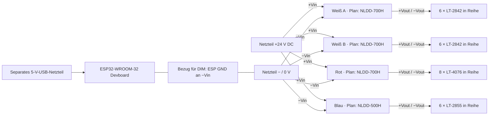
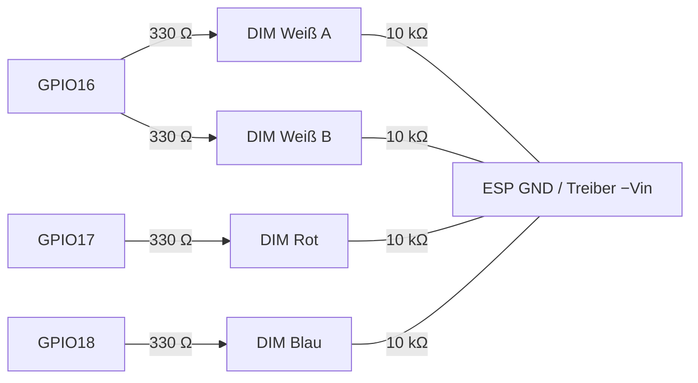

# Schaltplan der Aquariumleuchte

Der Plan zeigt die dokumentierte DC-Verschaltung. Laut Projektangaben hat jede Weißkette einen eigenen 700-mA-Treiber. Die Modellnummern im Plan sind Auslegungswerte. Die Aufdrucke der verbauten Treiber, die Widerstände und das Netzteiletikett sind von außen nicht sichtbar.

## Versorgung und LED-Ausgänge

An jeder LED-Kette führt `+Vout` zur Anode der ersten LED. Die Kathode jeder LED geht zur Anode der folgenden LED. Die Kathode der letzten LED führt zurück zu `−Vout` desselben Treibers. **Jede Kette bleibt am eigenen Ausgangspaar.** `−Vout` darf laut Mean Well nicht mit `−Vin` verbunden werden.

Das Datenblatt verlangt 4 V Reserve zwischen Eingangs- und Ausgangsspannung. Bei 24 V am Treibereingang bleiben also höchstens 20 V für die LED-Kette. Maßgeblich sind die tatsächliche Eingangsspannung am Treiber und die Vorwärtsspannung der gesamten Kette, auch bei kalten LEDs. Die 24 V sind der Planungswert. Das diskutierte Mean Well LRS-100-24 war ein Beispiel. Das tatsächlich verbaute Modell und die Absicherung sind offen.

## PWM-Anschlüsse

Die Widerstände sind Werte aus der ursprünglichen Planung. Jeder DIM-Eingang hat dort seinen eigenen Serienwiderstand und seinen eigenen Pull-down gegen `−Vin`. Die Firmware gibt 1.000 Hz mit aktiver High-Phase aus. Mean Well spezifiziert für NLDD-H 100–1.000 Hz, High über 2,5 V bis 5 V und Low unter 0,8 V, jeweils gegen `−Vin`. Ein offener DIM-Eingang schaltet den Treiber ein. Ob der geplante Pull-down den Eingang zuverlässig unter 0,8 V hält, muss am konkreten Modul auch beim Start und bei abgeschaltetem ESP gemessen werden.

## Anschlussnummern der Pin-Ausführung

Die folgende Belegung gilt für NLDD-500H und NLDD-700H mit Pins. Vor dem Löten mit der Gehäusezeichnung und ihrer Blickrichtung abgleichen.

| Funktion | Pins am NLDD |
| --- | --- |
| `−Vin` | 1, 2 |
| `−Vout` | 11, 12 |
| `+Vout` | 13, 14 |
| `PWM DIM` | 22 |
| `+Vin` | 23, 24 |

## Details zum Abgleich

- Typenschilder der vier Treiber und Netzteilbeschriftung.
- Bestückung und Orientierung der Treibermodule, Widerstände sowie Klemmen auf Vorder- und Rückseite der Platine.
- Ausführung von Absicherung, Zugentlastung und Spritzwasserschutz am realen Aufbau.
- Zuordnung der beiden Weißketten und thermische Anbindung der Sternplatinen an das Aluminiumprofil.

Die Zeichnung endet an den DC-Klemmen. Die Netzspannungsinstallation und ihre Schutzmaßnahmen gehören in die Hände einer Elektrofachkraft. Maßzeichnung, Pinbelegung und Grenzwerte je Variante stehen im [Mean-Well-Datenblatt NLDD-H](https://led.meanwell.com/Upload/PDF/NLDD-H/NLDD-H-spec.pdf).
